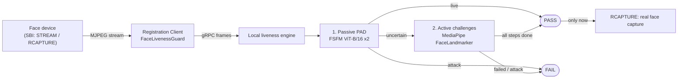

# Face Liveness and PAD for MOSIP Registration Clients

**Team DeLeetCode, IIIT Bangalore** · MOSIP Decode 2026 Hackathon · Problem statement 04: *Face Liveness Detection and
Presentation Attack Detection for Registration and Biometric Authentication*

> A printed photo, a replayed video or a deepfake should never become someone's registered face.
> We check that the person is live **before** the face is captured, in both MOSIP Registration Clients.

---

## The problem

MOSIP's Registration Clients capture a face from an L0/L1 device and trust it. Nothing checks whether the face
belongs to a live person. A photo held up to the camera, a phone replaying a video, or an AI-generated face can
all end up in a registration packet, an operator login or a supervisor approval.

## Our solution

We put a liveness gate in front of the capture. The client already streams video from the face device for the
preview. We tap that same stream and send the frames to a liveness engine running on the same machine. Only when
the person is verified as live does the client ask the device for the real capture. Full technical design [here](docs/TECHNICAL_DESIGN.md).



**Hybrid decision flow**

1. **Passive check.** Needs nothing from the user. Two FSFM ViT-B/16 models (CVPR 2025) score the face: one
   trained on print and replay attacks, one that also flags deepfake and AI-generated faces.
2. **Active challenge.** If passive is not sure, the person is asked to do a few random actions. The sequence is
   drawn with a secure random generator and changes on every retry, so a pre-recorded video cannot predict it.
3. **PAD keeps watching** during the challenges, so a replayed video of someone performing the action still fails.

## Features

- **Four desktop face flows covered:** resident registration, operator login, operator/supervisor authentication,
  supervisor end-of-day approval.
- **Android too:** on-device port of the same engine (ONNX Runtime + CameraX) for resident registration and
  operator onboarding.
- **12 challenge types:** blink, smile, open mouth, head left/right, look up/down, nod, four gaze directions.
  Tiers get harder when the passive score is weak.
- **Static photos cannot pass:** each action must go neutral, then action, then hold.
- **Fully offline, CPU only.** No cloud calls, no GPU.
- **Device-agnostic:** works with any SBI-compliant face device. We test with MOSIP's own MockMDS.
- **Configurable per workflow** through `mosip.registration.*` keys: thresholds, challenge pool, retries, timeouts,
  engine-failure policy.
- **Secure by default:** if the engine fails or the config is invalid, capture is denied and audited. It never
  silently lets a face through.

## Tech stack

| Layer | Tech |
|---|---|
| Passive PAD | PyTorch (CPU), FSFM / FS-VFM ViT-B/16 checkpoints |
| Active liveness | MediaPipe FaceLandmarker (478 landmarks, blendshapes, head pose) |
| Engine interface | gRPC + protobuf, bidirectional streaming (`:50051` active, `:50052` passive and hybrid) |
| Desktop client | Java 11, JavaFX, MOSIP `registration-client` 1.2.0.x |
| Android client | Flutter + Java, CameraX, ONNX Runtime, MOSIP `android-registration-client` 1.2.x |
| Test device | MOSIP MockMDS (SBI 0.9.5) fed by a webcam |

## Quick start

### Desktop demo (Linux & Windows)

Full steps for Linux and Windows are in the [Desktop setup guide](docs/DESKTOP_REGISTRATION_SETUP.md).

### Android

Build and run on a phone without a MOSIP server (mock backend): [Android setup guide](docs/ANDROID_SETUP.md).

### Engines on their own

```bash
cd face-liveness-active && conda env create -f environment.yml && conda activate face-liveness-active
python -m active_liveness.server          # 127.0.0.1:50051
```

For the passive and hybrid engine, see [face-liveness-passive/README.md](face-liveness-passive/README.md).

## Project structure

```text
.
├── face-liveness-active/    Active challenge engine (Python, gRPC :50051)
├── face-liveness-passive/   Passive PAD + hybrid sessions (Python, gRPC :50052) + ISO 30107 evaluation
├── face-liveness-desktop/   Java gRPC client library used by the Registration Client
├── mosip/
│   ├── registration-client/            MOSIP Desktop client (submodule)
│   ├── android-registration-client/    MOSIP Android client (submodule)
│   ├── mosip-mock-services/            MockMDS (submodule)
│   ├── patches/                        Our changes to the MOSIP repos
│   ├── scripts/                        setup, run-demo, start/stop services
│   └── tools/                          webcam feeder, performance and interop harness
├── docs/                    Technical design and setup guides
└── extras/                  JavaFX SDKs, MOSIP mock SDK
```

The MOSIP repositories are upstream submodules. Our changes to them are kept as patches in
[mosip/patches/](mosip/patches) and applied by [mosip/scripts/setup.sh](mosip/scripts/setup.sh).

## Documentation

| Document | What it covers |
|---|---|
| [Technical design](docs/TECHNICAL_DESIGN.md) | Architecture, streaming, decision flow, challenges, workflows, configuration, interfaces, error handling, security, ISO/IEC 30107, verification status |
| [Desktop setup](docs/DESKTOP_REGISTRATION_SETUP.md) | Run the Desktop Registration Client with liveness |
| [Android setup](docs/ANDROID_SETUP.md) | Run the Android Registration Client with liveness |
| [Active engine](face-liveness-active/README.md) | Challenges, escalation, gRPC protocol, tests |
| [Passive engine](face-liveness-passive/README.md) | Models, setup, hybrid mode, evaluation |

## Status and limitations

Tested (details in [Technical design §14](docs/TECHNICAL_DESIGN.md#14-verification-status)):

| Area | Tests |
|---|---|
| Passive engine, hybrid, gRPC | 182 |
| Active engine | 164 |
| Java client library | 16 |
| Desktop integration (real MOSIP classes, real engine, MockMDS) | 25 |
| Android engine parity | 17 |

