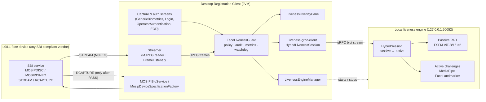
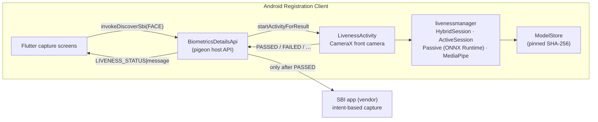
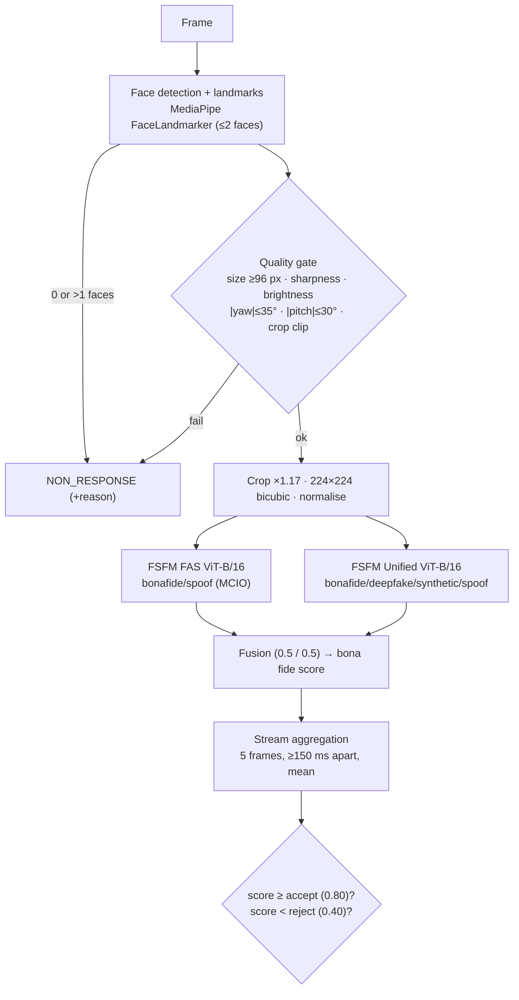
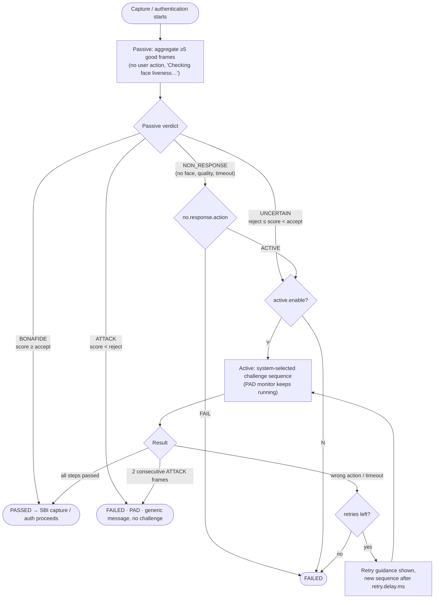
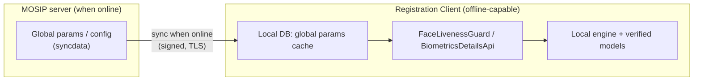

# Face Liveness and PAD for the MOSIP Registration Clients — Technical Design

Scope: problem statement *04 Face Liveness Detection and Presentation Attack Detection for Registration and
Biometric Authentication*. This document covers the Desktop Registration Client (MOSIP `registration-client`
1.2.0.x, Java/JavaFX) and the Android Registration Client (`android-registration-client` 1.2.x, Flutter + Java).

| Code | Location |
|---|---|
| Passive liveness / PAD engine, hybrid sessions, gRPC service | `face-liveness-passive/` (Python) |
| Active challenge engine | `face-liveness-active/` (Python) |
| Java gRPC client library used by the desktop client | `face-liveness-desktop/liveness-grpc-client/` |
| Desktop Registration Client changes | `mosip/registration-client` (submodule, branch `face-liveness`) |
| Android Registration Client changes, on-device engine | `mosip/android-registration-client` (submodule, branch `face-liveness`), module `android/livenessmanager` |
| L0/L1 device for development | `mosip/mosip-mock-services` (MOSIP MockMDS, SBI 0.9.5) + `mosip/tools/mockmds_webcam_feeder.py` |
| Performance / interoperability harness | `mosip/tools/perf_interop.py` |

---

## 1. High-level architecture





Design principles:

1. **Gate before capture.** Liveness runs *before* the SBI `RCAPTURE` (desktop) or SBI intent (Android). A face
   that fails liveness is never captured, so it cannot reach the packet, the operator's credentials or the
   supervisor's approval.
2. **Same engine everywhere.** The Android module is a line-by-line port of the Python engines, and parity tests
   check it: preprocessing is bit-exact with Pillow, the ONNX models match PyTorch within 1e-4, and whole-frame
   decisions and quality reasons match the Python engine.
3. **Local and offline.** The engine runs on the client machine (desktop: loopback gRPC, auto-started by the
   client; Android: in-process). Network state never decides whether liveness is enforced.
4. **Vendor independence.** The desktop uses only the MOSIP SBI `STREAM` interface, which every Registration-purpose
   device implements. The engine accepts any frame encoding OpenCV decodes, plus raw RGB/BGR. No vendor SDK is
   linked.

## 2. Face frame streaming architecture

**Desktop.** The client already opens the SBI `STREAM` for the live preview: `Streamer` reads the multipart MJPEG
response and renders it. The integration adds a `Streamer.FrameListener` (`onFrame(byte[] jpeg)`,
`onStreamStopped()`), so the same frames feed liveness with no second device connection.

| Concern | Design |
|---|---|
| Continuous / periodic processing | Every frame is offered; `HybridLivenessSession` rate-limits to `max.fps` (default 15). gRPC flow control (`isReady`) drops frames instead of queueing when the engine is busy, so latency does not grow. |
| Frame formats | MJPEG parts from SBI. The engine also accepts PNG/BMP/WebP and raw RGB/BGR (`FrameEncoding`). Interoperability check I1 verifies one decision across seven encodings. |
| Invalid / incomplete frames | The guard drops non-JPEG frames before sending them. 30 consecutive invalid frames end the session as a device error. The engine also rejects undecodable data with `INVALID_ARGUMENT`; check I3 verifies the engine keeps serving afterwards. |
| Device never streams | A watchdog ends the session after `device.frame.timeout.seconds` (default 10) without a valid frame. |
| Device disconnects | The stream ends (EOF); `Streamer` raises `EOFException` and notifies `onStreamStopped`, and the session ends as a device error. This fixes a pre-existing bug in MOSIP's `Streamer`: on EOF, `while (read() != 255)` spun forever at 100 % CPU and never reported the stop. |
| Thread model | Frames arrive on the streamer thread; the listener must not block. Sending runs on a single sender executor. `verify()` blocks a background task, never the FX thread (it throws if called there). |

**Android.** Android SBI devices are separate apps driven by intents and return a single capture, not a stream.
Liveness therefore uses the device's own camera through **CameraX** (front camera, `ImageAnalysis` RGBA,
keep-only-latest back-pressure). Frames are made upright with the rotation the camera reports, and are not
mirrored, matching the desktop engine's convention.

## 3. Liveness and PAD processing architecture



- **Passive liveness**: two FSFM ViT-B/16 models (CVPR 2025). The *FAS* model is fine-tuned on MSU-MFSD,
  CASIA-FASD, Idiap Replay-Attack and OULU-NPU (print and replay attacks). The *Unified* model also flags
  deepfake and AI-generated faces (injection attacks). The fused bona fide probability is the PAD score.
- **Quality / confidence**: per frame, the quality gate yields reasons (`FACE_TOO_SMALL`, `BLURRY`, `TOO_DARK`,
  `POSE`, …). Frames that fail it give no score; they do not lower one.
- **PAD**: an ATTACK decision (score < reject threshold) fails the session immediately, and *during* active
  challenges a sampled PAD monitor (every 1 s) aborts on 2 consecutive ATTACK frames. A replayed video of
  someone performing the challenge is therefore still checked by PAD.
- **Desktop runtime**: PyTorch on CPU. **Android runtime**: the same
  models exported to ONNX FP32 (`scripts/export_onnx.py`; int8 was rejected because it drifted the score by up
  to 0.074), run with ONNX Runtime for Android.

## 4. Passive-to-active decision flow



## 5. Dynamic challenge mechanism

- **Pool**: blink, smile, open mouth, turn head left/right, look up/down, nod, gaze left/right/up/down
  (12 actions, grouped into EASY/MEDIUM/HARD tiers). The pool can be restricted per workflow
  (`active.challenge.types`).
- **Selection**: the planner draws `min.challenges` steps (default 3) with rising tiers, using a CSPRNG
  (`secrets.SystemRandom` on desktop, `SecureRandom` on Android). No action repeats within an attempt until the
  pool is exhausted, and every retry gets a new sequence, so a pre-recorded response cannot anticipate the order.
  When `compound.challenges` is on, a HARD step may require two actions in order.
- **Escalation**: a passive score below `passive_weak_threshold` (0.5) adds a HARD step, and a step passed with a
  margin below `weak_margin` (0.15) adds another, capped at `max_extra_challenges` (2) per attempt. The less the
  evidence trusts the face, the more the subject must do.
- **Per-step timeouts**: e.g. 8 s / 6 s / 5 s (configurable list, the last value repeats). Thresholds widen with
  the tier (yaw 15° → 25°).
- **Action validation**: blendshape and head-pose state machines. Each action needs a **neutral → action →
  hold** sequence (`neutral_frames`, `hold_frames`), so a static photo or a held expression cannot pass. The wrong
  action (e.g. right instead of left) fails the step immediately. Gaze steps require the head to stay still.
- **Capability-driven**: the engine advertises its supported challenge types in `GetInfo.capabilities`, and the
  Device Settings diagnostics show them. A configured type outside the supported set is an invalid configuration
  (capture denied, audited). Both the client policy builder and the engine's `resolve_policy` reject it.

## 6. Workflow integration

### 6.1 Resident registration (desktop)

```mermaid
sequenceDiagram
  autonumber
  actor R as Resident
  participant UI as GenericBiometricsController
  participant G as FaceLivenessGuard
  participant S as Streamer
  participant E as Liveness engine
  participant B as BioService / SBI
  UI->>S: STREAM (live preview)
  UI->>G: verify(RESIDENT, overlay, startStream, applicationId)
  G->>E: HybridStart(workflow=RESIDENT, policy from global params)
  loop every frame (≤15 fps)
    S-->>G: JPEG frame
    G->>E: Frame
    E-->>G: progress / challenge / feedback
    G-->>UI: overlay: "Checking face liveness…", "Please blink", "Action detected"
  end
  E-->>G: Decision PASSED | FAILED
  alt PASSED
    G-->>UI: Verdict.allowed (audit REG-EVT-104)
    UI->>B: RCAPTURE face
    B-->>UI: face biometric → packet
  else FAILED / timed out / device error
    G-->>UI: Verdict + user message (audit 105 / 106 / 109)
    UI-->>R: failure guidance; capture not accepted; retry within policy
  end
```

### 6.2 Operator authentication (desktop)

Operator face login (`LoginController`, workflow OPERATOR, subject = user ID) and operator authentication for
packet approval (`AuthenticationController` with `isReviewer = false`). The guard runs before the face
`RCAPTURE` that feeds MOSIP's local face match. Authentication completes only when **liveness PASSED and the
face matched**, so liveness adds a control proving that the matched face belongs to a live person. On failure
the liveness message is passed to `validateInvalidLogin`, which shows it and applies MOSIP's own invalid-login
counting.

```mermaid
sequenceDiagram
  autonumber
  actor O as Operator
  participant L as LoginController / AuthenticationController
  participant G as FaceLivenessGuard
  participant E as Liveness engine
  participant M as MOSIP local face match
  O->>L: choose FACE login / auth
  L->>G: verify(OPERATOR, overlay, startStream, userId)
  G->>E: hybrid session on the device stream
  E-->>G: PASSED / FAILED
  alt PASSED
    L->>M: RCAPTURE + match against the operator's synced template
    M-->>L: match / no match
  else not PASSED
    L-->>O: liveness message (generic for PAD); login refused
  end
```

### 6.3 Supervisor authentication (desktop)

The same flow under the **SUPERVISOR** workflow policy (which may be stricter, e.g. a higher threshold or more
challenges). It applies to supervisor authentication during packet approval (`AuthenticationController` with
`isReviewer = true`) and to end-of-day approval (`EODAuthenticationController`, `Authentication.fxml`).

### 6.4 Android

| Workflow | Android Registration Client 1.2.x | Liveness |
|---|---|---|
| Resident face capture | Biometric capture screens (`invokeDiscoverSbi(FACE)`) | `LivenessActivity` before the SBI intent, RESIDENT policy |
| Operator biometric onboarding | `fieldId == operatorBiometrics` | Same gate, OPERATOR policy |
| Operator login / supervisor approval | Upstream 1.2.x supports **password only**; there is no face authentication screen to integrate into | Not applicable until upstream adds face authentication. The gate then applies unchanged: `LivenessActivity` takes `liveness.workflow = operator / supervisor` |

The result returns through `MainActivity.onActivityResult → BiometricsDetailsApi.onLivenessResult`. The SBI
intent starts only on PASSED (or on an engine error when `engine.error.policy = ALLOW`). Otherwise Flutter
receives `LIVENESS_<STATUS>|<message>`, shows the message, and does not consume a MOSIP capture attempt
(`lib/utils/face_liveness.dart`).

## 7. Online and offline architecture



- Every liveness step runs locally: detection, PAD, challenge generation and action validation. Offline
  registration and offline operator/supervisor authentication behave exactly like online.
- **Configuration** uses MOSIP's existing configuration framework: `mosip.registration.face.liveness.*` global
  parameters, synced by the standard syncdata job when online and read from the local cache offline. A
  machine-local `-D` system property is the fallback for development.
- **Models**:
  - **Desktop:** the engine verifies the SHA-256 of each checkpoint against its pinned configuration at start-up
    (`models.verify_sha256: true`) and refuses tampered files.
  - **Android:** the approved model package (version plus SHA-256 per file) is pinned in the APK. Models are
    provisioned offline into the app's import folder (e.g. by device management or `adb`). `ModelStore` verifies
    each file and only then moves it into private storage.

  A model update is therefore delivered either as a new pinned manifest with the client release (online, through
  the normal client upgrade) or as files that must match the manifest. An unapproved model can never be loaded.

## 8. Configuration design

Global parameters (MOSIP `mosip.registration.*` namespace). `[wf.]` is optional: `resident`, `operator` or
`supervisor`. A per-workflow key wins over the shared key; unset policy keys keep the engine defaults. The same
keys drive both the desktop and Android clients.

| Key (`mosip.registration.face.liveness.` + …) | Values (default) | Requirement |
|---|---|---|
| `enable`, `[wf.]enable` | Y/N (Y) | enable/disable liveness, per workflow |
| `[wf.]passive.threshold` | 0..1 (0.80) | passive quality/confidence threshold |
| `[wf.]passive.reject.threshold` | 0..1 (0.40) | PAD attack threshold |
| `[wf.]passive.no.response.action` | ACTIVE / FAIL (ACTIVE) | behaviour when passive gets no usable face |
| `[wf.]active.enable` | Y/N (Y) | active liveness enablement |
| `[wf.]active.min.challenges` | ≥1 (3) | minimum number of challenges |
| `[wf.]active.challenge.types` | comma list (all 12) | supported challenge types / challenge pool |
| `[wf.]active.compound.challenges` | Y/N (Y) | multi-action challenges |
| `[wf.]active.challenge.timeout.seconds` | comma list per step (8,6,5) | challenge timeout |
| `[wf.]active.max.retries` | ≥0 (3) | maximum retry count within a session |
| `[wf.]repeated.failure.max.sessions` | ≥1 (3) | failed sessions before the repeated-failure action |
| `[wf.]repeated.failure.action` | BLOCK / CONTINUE (BLOCK) | behaviour on repeated failure |
| `engine.error.policy` | DENY / ALLOW (DENY) | behaviour when the engine fails |
| `device.frame.timeout.seconds` | (10) | device unavailable detection (desktop) |
| `session.timeout.seconds`, `max.fps`, `retry.delay.ms` | (180, 15, 3000) | session limits / pacing |
| `service.host`, `service.port`, `service.autostart`, `service.command`, `service.workdir`, `service.log`, `service.startup.timeout.seconds` | (127.0.0.1, 50052, Y, …, 120) | engine management (desktop) |

Validation: the engine checks the effective policy (`0 ≤ reject ≤ accept ≤ 1`, known challenge types, positive
timeouts). An invalid policy is **not** silently replaced. The capture is denied and `REG_FACE_LIVENESS_ENGINE_ERROR`
is audited, so a misconfiguration cannot weaken security unnoticed. The effective policy of every session is
logged (`policy_json`).

## 9. Device integration interface

| Layer | Interface | Notes |
|---|---|---|
| Device ↔ client | MOSIP SBI 0.9.5 / 1.0: `MOSIPDISC`, `MOSIPDINFO`, `STREAM`, `RCAPTURE` | Unchanged MOSIP device framework (`MosipDeviceSpecificationFactory`, SBI providers). Works with any certified vendor; MockMDS is MOSIP's reference device |
| Client stream abstraction | `Streamer.FrameListener { onFrame(byte[] jpeg); onStreamStopped(); }` | Common frame interface for every face device |
| Capability discovery | `MOSIPDINFO` (spec version, purpose, status, sub-IDs) + engine `GetInfo.capabilities` | Shown in Settings → Device Settings → *Face liveness diagnostics*. A purpose other than Registration is reported as "no stream" |
| Android | CameraX `ImageAnalysis` → `LivenessActivity`; SBI intents unchanged | `LivenessContract` (intent extras in, status/reason/score out) |

## 10. Liveness engine interface

gRPC service `mosip.liveness.passive.v1.PassiveLivenessService` (`face-liveness-passive/proto/passive_liveness.proto`):

| RPC | Use |
|---|---|
| `HybridSession(stream HybridClientMessage) → stream HybridServerMessage` | The workflow gate: `HybridStart{workflow, SessionPolicy}`, then `Frame`s, `Retry` and `Cancel`. The server streams `HybridStarted{policy_json}`, `PassiveProgress`, `PassiveVerdict`, `active` challenge prompts, feedback and results, `MonitorResult`, `HybridDecision{status, reason, message, passive_score}` and `Error` |
| `AnalyzeImage`, `AnalyzeStream`, `AnalyzeVideo` | Passive-only analysis (diagnostics, evaluation, benchmark) |
| `GetInfo` | Models (file, SHA-256, licence), `capabilities` (modes, workflows, challenge types, attack classes, frame encodings, integrity check), effective configuration |

Java facade (`liveness-grpc-client`): `FaceLivenessClient.startHybrid(workflow, policy, listener) →
HybridLivenessSession` with `offerFrame`, `cancel` and `awaitOutcome`. It emits `LivenessUpdate` (CHECKING,
CHALLENGE, FEEDBACK, CHALLENGE_RESULT, RETRY, DONE) and returns `LivenessOutcome` (PASSED, FAILED, CANCELLED,
TIMED_OUT, ENGINE_ERROR). The jar is shaded and relocated, so it cannot conflict with the client's own gRPC,
Guava or protobuf versions.

## 11. Error handling and recovery

| Condition | Detection | User sees (desktop & Android) | Recovery | Audit |
|---|---|---|---|---|
| Device unavailable | no valid frame for 10 s | "The face camera is not sending images. Check that the device is connected and try again." | retry after fixing the device; not counted as a liveness failure | REG-EVT-109 |
| Device connection failure / disconnect | stream EOF → `onStreamStopped` | "The face camera was disconnected. Reconnect the device and try again." | same | 109 |
| Camera unavailable (Android) | CameraX bind failure | "Camera unavailable. Please check the camera and try again." | same | ENGINE_ERROR (118) |
| Face not detected | 0 faces | "Keep your face within the capture area" (live) | continues; passive non-response → active or fail by policy | — |
| Multiple faces | >1 face | "Only one person should be in front of the camera" | continues | — |
| Poor face quality | quality gate (size, blur, light, pose) | positioning guidance ("Hold still and look at the camera", "Keep your face within the capture area") | continues; frame not scored; on persistent failure, passive non-response → active or fail by policy | — |
| Liveness below threshold | UNCERTAIN | challenge prompt, e.g. "Please blink" | active verification | — |
| PAD failure | ATTACK (passive or monitor) | "Face verification could not be completed. Please try again." (no attack details) | retry allowed within the repeated-failure policy | 106 |
| Active challenge failure | wrong action / no action | "We could not verify face liveness. Please try again." + 5 guidance tips | automatic retry with a new sequence | 105 at the end |
| Challenge timeout | per-step timeout | same as above | same | 105 |
| Maximum retries exceeded | retries = `max.retries` | "Face verification could not be completed. Please follow the applicable recovery process." | session fails; after `repeated.failure.max.sessions` the subject is blocked (BLOCK) | 105, then 108 |
| Invalid / incomplete frame data | non-JPEG / undecodable | dropped silently; 30 in a row → "The face camera is sending unreadable images…" | device check | 109 |
| Liveness engine error | engine unreachable / fails to start / invalid policy | "Face verification could not be completed. Please try again." | auto-start of the bundled engine; `engine.error.policy` DENY (default) or ALLOW | 107 |

## 12. Security and privacy

- **No biometric data leaves the client for liveness.** Desktop frames go only to `127.0.0.1`. Android frames are
  never written to storage.
- **No images, landmarks or embeddings in logs or audits.** Logs hold the decision, reason, score, timing and
  session ID. Audits hold event codes against the application ID or user ID (MOSIP's audit trail).
- **No PAD details to the user.** Every PAD outcome shows the same generic message, so attackers get no oracle.
  Attack class and score are available only in the audit and diagnostic log.
- **Anonymised metrics** per workflow (counts, rates, average times) carry no subject identifiers.
- **Fail closed.** Engine errors deny capture by default, invalid configuration denies capture, and a disabled
  workflow is explicit and audited in the configuration.
- **Model integrity.** Pinned SHA-256 on both platforms; Android keeps models in app-private storage.
- **Repeated-failure lock** per subject (application ID or user ID), so failed attempts cannot be iterated
  without limit.
- **Replay resistance.** Unpredictable challenge order, a fresh sequence per retry, neutral→action→hold
  validation, and PAD monitoring during the challenges.
- **Licence note.** The FSFM checkpoints are CC BY-NC 4.0 (research). A production deployment must substitute
  commercially licensed weights; only the model files and their pinned hashes change.

## 13. ISO/IEC 30107 alignment

Details: `face-liveness-passive/docs/ISO30107_CONFORMANCE.md`. Summary:

- **30107-1:** bona fide / attack / non-response decisions with a PAD score; PAI species print and replay; human
  non-conformance handled by the quality gate and active challenges; per-workflow supervision level through the
  workflow policies.
- **30107-3:** `passive-liveness-eval` computes APCER per PAI species, worst-case APCER, BPCER, APNRR/BPNRR,
  BPCER@APCER, DET curves and Wilson intervals at the deployed thresholds.
- **Not yet done:** measured APCER/BPCER on a licensed PAD dataset captured on the target devices. That is an
  evaluator activity: test crew, artefact creation and attack-potential rating.
- **Mobile (30107-4):** Android runs the same models and decision rules, and is parity-tested.

## 14. Verification status

| Area | Evidence |
|---|---|
| Passive engine, hybrid, gRPC, session policy | `face-liveness-passive/tests`: 182 tests |
| Active engine | `face-liveness-active/tests`: 164 tests |
| Java client library | `HybridLivenessSessionTest`: 16 tests |
| Desktop integration with the real MOSIP classes, a real engine and MockMDS | `FaceLivenessGuardTest`: 18 tests (policy, engine errors, device unavailable/disconnect/invalid frames, repeated-failure block, auto-start, diagnostics) |
| Android engine parity and sessions | `livenessmanager` JVM tests: 17 (Pillow bit-exact, ONNX within 1e-4, whole-frame decisions) |
| Performance / interoperability | `mosip/tools/perf_interop.py` (written, not yet run; results will go in `docs/PERFORMANCE_INTEROP.md`) |
| Not verified yet | Desktop UI against a real MOSIP backend (the full deployment needs ~192 GB RAM; a minimal 1.2.0.1 stack is planned but not yet scripted or run); Android on a device or emulator |
